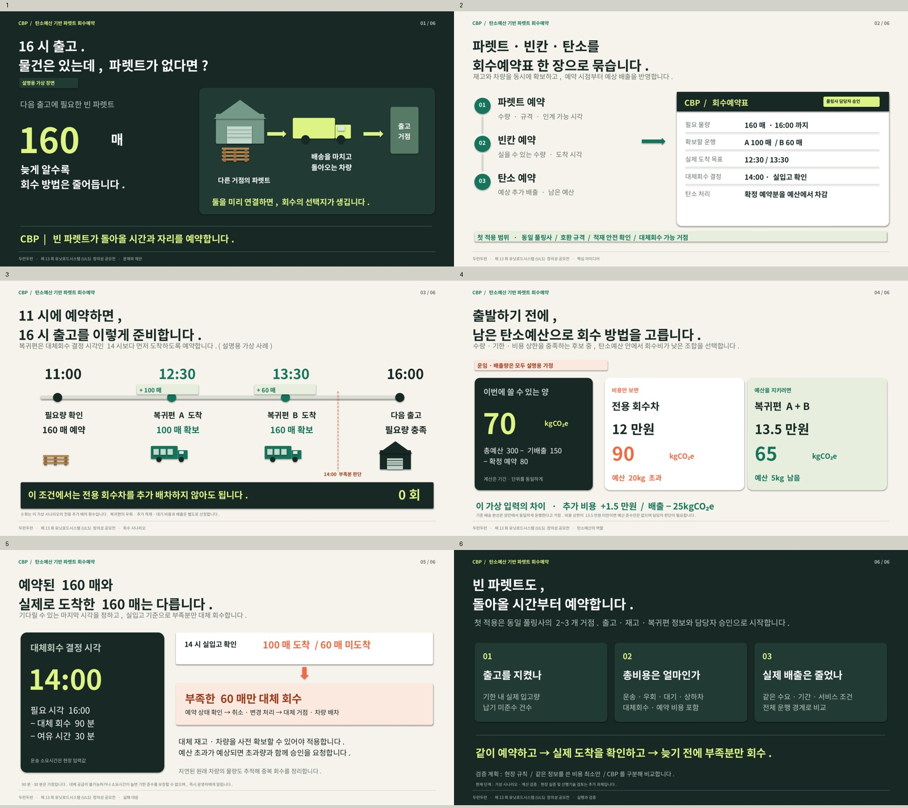

# CBP 본선 발표 검토안

## 최신: V2 회수예약표

- [V2 메인 발표 PDF](v2/cbp-main-v2.pdf)
- [V2 편집 가능한 메인 PPT](v2/cbp-main-v2.pptx)
- [V2 전체 파일 ZIP](v2/cbp-v2-all.zip)
- [V2 파일 설명](v2/README.md)

파렛트·차량 빈칸·탄소예산을 함께 예약하고, 실제 입고량을 기준으로 부족분을 대체 회수하는 방식으로 재구성했습니다.

## 이전 검토안 V1

- [메인 발표 PPT](cbp-main.pptx)
- [메인 발표 PDF](cbp-main.pdf)
- [전체 파일 ZIP](cbp-all-files.zip): 배너용 4쪽 발췌본, 대본·검토 문서, 계산 데모와 소스 포함

메인 발표는 4분 기준 6장으로 구성했고, 그중 2~5장을 배너용으로 발췌했습니다.
모든 운임·배출량 수치는 작동 원리 설명용 가정입니다. 현장 실증 결과가 아닙니다.
아직 제출하지 않은 검토안입니다.
