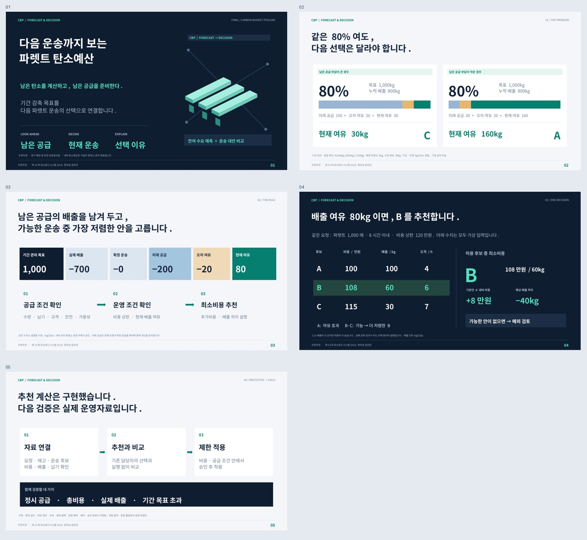

# CBP 최종 연구제안 · 2026.10.21

**다음 운송까지 보는 파렛트 탄소예산.** 앞으로 처리할 공급의 예상 배출을 남겨 두고, 현재 공급·납기·안전·비용 조건을 충족하는 후보 중 최소비용 운송을 추천합니다.

## 바로 받기

| 파일 | 내용 |
|---|---|
| [최종 연구보고서 PDF](cbp-final-report.pdf) | 27쪽: 배경·문제·문헌·예산 정의·모형·계산·예외·실험·실증·한계·질의응답 |
| [본발표 PPT](cbp-final-main.pptx) / [PDF](cbp-final-main.pdf) | 4분 발표용 5장, 발표자 노트 포함 |
| [통합 PPT](cbp-final-full.pptx) / [PDF](cbp-final-full.pdf) | 본발표 5장 + 질의응답 8장 |
| [배너 PPT](cbp-final-banner.pptx) / [PDF](cbp-final-banner.pdf) | 본발표 2~5장을 그대로 발췌한 4장 |
| [질의응답 PPT](cbp-final-appendix.pptx) / [PDF](cbp-final-appendix.pdf) | 근거·예산·수식·예외·배출 산정·실험·실패·실증 |
| [전체 묶음 ZIP](cbp-final-package.zip) | 위 파일 + 대본 + 데모 + 계산·제작·검수 소스 |
| [발표대본](발표대본_4분.md) | 3분 50초 목표 + 전환·호흡 10초 여유, 리허설 후 조정 |
| [추천 데모 다운로드](demo.html) | 파일 저장 후 브라우저에서 열기, 인터넷 연결 없이 작동 |

GitHub 파일 미리보기가 열리지 않으면 파일 화면의 **Download raw file**을 사용하세요. 다운로드 직접 주소의 기본 경로:

`https://github.com/shshwk33-stack/UNIT/raw/refs/heads/cbp-final-review-20261019/deliverables/final/`



## 이번에 달라진 점

- 로지스올이 이미 배차용 탄소예산을 운영한다는 전제를 사용하지 않았습니다.
- 내부 관리 목표, 법정 배출권, 탄소 크레딧을 구분했습니다.
- 기존 CUR 가중치 모형에서 **미래 공급 예상 배출 F와 오차 여유 U를 반영한 현재 배출 여유 H**로 판단 규칙을 개정했습니다.
- 원안의 목적은 유지하되, RPS 가중합은 현재 허용 후보의 최소비용 선택으로 교체했습니다. 이전 버전의 점수·사례와 섞어 사용하지 않습니다.
- 공급·안전·비용 조건을 먼저 검사하며, 목표에 맞는 후보가 없으면 예외 대안과 계획 여유 부족량을 제시합니다.
- 확인된 사실·문헌 초록·서지·설계 가정·합성 계산·현장 미검증을 구분했습니다.

## 근거와 한계

ISO 14083 공식 소개, 파렛트 공급망 검토논문의 공개 초록, 관련 선행연구의 서지를 확인했습니다. 확인 수준과 DOI는 보고서 26쪽, 접속 로그와 서지는 `research/`에 있습니다. 논문 전문을 모두 검토한 체계적 문헌고찰이나 특허 신규성 조사는 아닙니다.

모든 운임·배출량·예측·예산 예시는 가상 입력입니다. 회사 데이터·실제 배차·예측 학습·장부 정산과 연결되지 않았습니다. 합성 요청열 결과는 현장 감축률이 아닙니다. 본선 제출이나 외부 발송은 하지 않았습니다.

## 검수

- Python 모형의 683개 단언 통과: 반복 입력 범위 검사와 오류·예외 분기 포함.
- 합성 실험 9개 정책/오차 조합, 총 180단계 결과를 별도 유리수 계산으로 대조.
- 브라우저 데모와 Python 사례 일치, 잘못된 입력·복구·모바일 가로 넘침 검사.
- 보고서 27쪽 목차·참고문헌 링크·글자 경계·폰트 포함·깨진 문자 검사.
- PPT/PDF 페이지 수, 도형 경계·발표자 노트 검사.
- 배너 4장과 본발표 2~5장: 도형·노트 동일, PDF 렌더 픽셀 동일.
- 보고서 27쪽과 통합 슬라이드 13장 화면 검토.

검수는 파일·계산의 정합성 확인이며 외부 학술심사나 현장 실증은 아닙니다. 최종 기록은 `verification.json`, 해시는 `SHA256SUMS.txt`에 있습니다.

## 재현

Python 3, python-pptx, PyMuPDF, lxml, matplotlib, Pillow, Node.js와 Playwright, Chromium(`/usr/bin/chromium`), LibreOffice, Poppler(`pdffonts`)가 필요합니다. 폰트는 Noto Sans CJK KR을 사용했습니다. 다른 편집 환경에서는 대체 폰트가 적용될 수 있으므로 PDF와 함께 확인하세요.

현재 폴더에서 실행:

```bash
python model.py
MPLCONFIGDIR=/tmp/cbp-mpl python make_figures.py
python build_report.py
node render_report.cjs
python build_deck.py
soffice -env:UserInstallation=file:///tmp/cbp-final-lo --headless --convert-to pdf --outdir . cbp-final-main.pptx cbp-final-banner.pptx cbp-final-appendix.pptx cbp-final-full.pptx
node verify_demo.cjs
python verify_all.py
```

PDF 제작과 데모 검수용 로컬 서버는 스크립트가 열고 종료합니다. 상시 서버는 필요하지 않습니다. 그림은 데이터에서 생성하며 PPT의 글자·도형은 편집 가능합니다.
