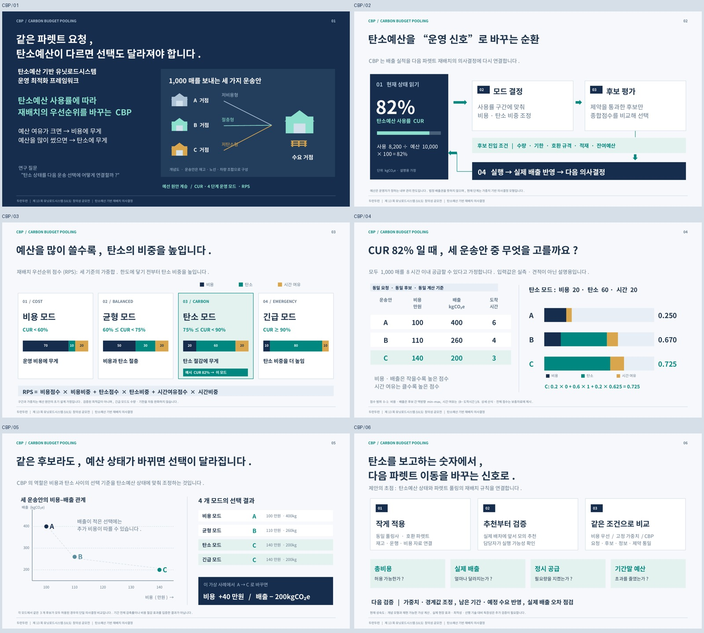

# CBP V3 — 원안 기반 학술 발표형

**“탄소예산을 얼마나 썼는지에 따라, 파렛트를 옮기는 기준을 바꾼다.”**

예선 CBP의 CUR, 4단계 운영 모드, RPS를 유지하고 수식·숫자 예시·운영 제약을 일관되게 정리했습니다. 회수예약제가 중심이었던 V2에서 원래 아이디어로 돌아온 버전입니다.

- [발표 PPT 다운로드](https://github.com/shshwk33-stack/UNIT/raw/refs/heads/cbp-final-review-20261019/deliverables/v3/cbp-main-v3.pptx)
- [발표 PDF 보기](cbp-main-v3.pdf)
- [전체 자료 ZIP 다운로드](https://github.com/shshwk33-stack/UNIT/raw/refs/heads/cbp-final-review-20261019/deliverables/v3/cbp-v3-all.zip)
- [배너 발췌 PPT](cbp-banner-v3.pptx)
- [연구 보충자료 PDF](cbp-research-v3.pdf)



## 구성

| 파일 | 용도 |
|---|---|
| `cbp-main-v3.pptx` / `.pdf` | 4분 목표, 본 발표 6장. 편집 가능한 글자·도형·그래프와 발표자 노트. |
| `cbp-banner-v3.pptx` / `.pdf` | 본 발표 2–5장을 그대로 발췌한 4장. |
| `cbp-research-v3.pptx` / `.pdf` | 상세 모형·계산표·민감도·현장 예외·실증 설계 5장. 본 발표 외 보충자료. |
| `발표대본_4분.md` | 장별 대본과 목표 시간. 실제 낭독으로 조정할 것. |
| `아이디어_이해와_심사대응.md` | 쉬운 설명, 원안 변경 내역, 예상 질문과 답변. |
| `scenario.csv`, `model_results.json` | 가상 입력, 정규화 점수, 모드별 RPS와 선택 결과. |
| `figures/` | 가중치 민감도 그래프 PNG·SVG·PDF. |
| `model.py`, `build_deck.py`, `verify.py` | 계산·그래프·PPT 생성 및 검증 소스. |

## 읽는 순서

1. 발표 PDF 6장을 봅니다.
2. `아이디어_이해와_심사대응.md`로 계산과 예상 질문을 이해합니다.
3. 대본을 소리 내어 읽으며 4분 리허설을 합니다.
4. 연구 보충자료는 필요한 질의응답에 사용합니다.

숫자는 설명용 가정입니다. 현장 감축 실적이나 검증된 최적 가중치가 아닙니다. 원안의 검증되지 않은 감축률·절감률은 사용하지 않았습니다. 외부 선행 연구와 역대 수상작의 원문 비교는 이번 자료에서 확인하지 못했습니다.

## 제출·편집

제공된 안내 기준 배너 자료 제출은 **2026년 10월 21일 17:00(한국시간)**입니다. 본 발표에서 발췌한 4쪽을 제출하는 형식이며, 주최 측에 이메일을 보내지는 않았습니다.

글꼴은 **Noto Sans CJK KR**입니다. PPT의 본문과 대부분의 도형·그래프는 편집 가능하며, 연구 보충자료의 민감도 그래프는 이미지입니다. 다른 컴퓨터에서 글꼴이 대체되면 줄바꿈이 달라질 수 있으므로 함께 제공한 PDF와 비교하세요.

## 재생성

필요 환경: Python 3, python-pptx, numpy, matplotlib, pypdf, lxml, Noto Sans CJK 글꼴, LibreOffice. 이 작업 환경에서는 `soffice`로 PDF 변환을 확인했습니다.

```bash
MPLCONFIGDIR=/tmp/cbp-mpl python model.py
MPLCONFIGDIR=/tmp/cbp-mpl python build_deck.py
soffice --headless --convert-to pdf --outdir . cbp-main-v3.pptx cbp-banner-v3.pptx cbp-research-v3.pptx
MPLCONFIGDIR=/tmp/cbp-mpl python verify.py
```

`model.py`의 글꼴 경로는 실행 환경에 맞게 변경할 수 있습니다. 검증 대상은 가상 계산의 산술, 임계값 경계, 문서 구성·노트·도형 범위, 배너의 원본 동일성입니다. 현장 운영 효과에 대한 실험은 수행하지 않았습니다.
