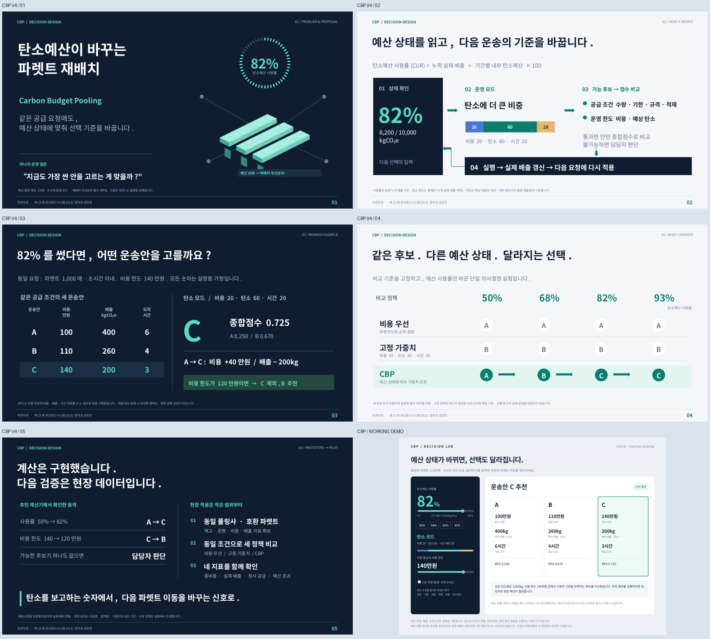
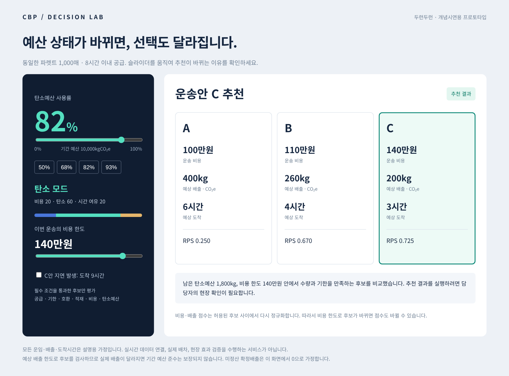

# CBP V4 — 탄소예산이 바꾸는 파렛트 재배치

사용자가 제공한 피드백을 검토해 원안의 CUR·4모드·RPS를 유지하면서 발표를 **5장**으로 압축했습니다. 비용 한도와 실행 가능 후보 검사를 실제 구현하고, 작동하는 추천 데모를 추가했습니다.

- [본문 PPT 다운로드](https://github.com/shshwk33-stack/UNIT/raw/refs/heads/cbp-final-review-20261019/deliverables/v4/cbp-main-v4.pptx)
- [본문 PDF 보기](cbp-main-v4.pdf)
- [전체 자료 ZIP 다운로드](https://github.com/shshwk33-stack/UNIT/raw/refs/heads/cbp-final-review-20261019/deliverables/v4/cbp-v4-all.zip)
- [본문+보충 통합 PPT](cbp-full-v4.pptx)
- [배너용 4쪽 PPT](cbp-banner-v4.pptx)
- [피드백의 채택·수정·보류 이유](피드백_판정과_제작전략.md)



## 파일 안내

| 파일 | 용도 |
|---|---|
| `cbp-main-v4.pptx` / `.pdf` | 본 발표 5장. 목표 3분50초+여유10초. 대본은 발표자 노트에도 포함. |
| `cbp-banner-v4.pptx` / `.pdf` | 본문 2–5장과 동일한 배너용 4쪽. |
| `cbp-research-v4.pptx` / `.pdf` | 수식·전체 점수·예외·한계·실증·근거의 보충자료 6장. |
| `cbp-full-v4.pptx` / `.pdf` | 본문 5장 뒤에 보충 6장을 붙인 11장 통합본. 4분 발표는 앞 5장까지만. |
| `cbp-demo.html` | ZIP을 푼 뒤 브라우저로 여는 오프라인 추천 데모. |
| `figures/demo.png` | 동작하는 데모 화면 캡처. |
| `발표대본_4분.md` | 장별 시간 목표와 설명 순서. |
| `심사질문_답변.md` | 예상 질문 15개와 답변, 피해야 할 주장. |
| `피드백_판정과_제작전략.md` | 피드백 판단 근거와 추가로 발견한 논리 문제. |
| `research/` | 조사 시도·접근 한계·후속 검색 질문. 확인하지 않은 문헌을 인용하지 않음. |
| `cbp_model.py`, `scenario.csv`, `model_results.json` | 실행 가능한 후보 검사·점수 모형과 가상 입력/결과. |
| `build_deck.py`, `verify_artifacts.py`, `verify_demo.cjs` | PPT 재생성·문서 검증·브라우저 동작 검증 소스. |

## 무엇이 달라졌나

1. 제목을 ‘탄소예산이 바꾸는 파렛트 재배치’로 명확하게 했습니다.
2. 설명 순서를 문제→운영 흐름→한 사례→고정 기준과 비교→구현·실증으로 정리했습니다.
3. 비용 상한을 두어 비싼 저탄소 안을 무조건 추천하지 않도록 했습니다.
4. 수량·기한·규격·적재·비용·예산 제약과 가중치 평가를 코드에서 분리했습니다.
5. 큰 숫자, 상태 링, 기하학적 파렛트, 가중치 막대, 정책별 선택 매트릭스로 다시 디자인했습니다. PPT의 글자와 도형은 편집 가능합니다.



## 자료의 범위

운임·배출·도착시간은 **설명용 가정**입니다. 코드는 선택 규칙이 작동함을 보여 주지만 실제 비용·탄소 감축 효과를 입증하지 않습니다. 원안의 경계값과 가중치는 검증된 최적값이 아닙니다. 외부 학술·공모전 사이트 접근이 네트워크에서 차단되어 선행 연구·수상작 원문 비교를 완료하지 못했습니다.

네트워크 허용 도메인 추가 초안은 저장했습니다. 환경 설정에서 검토·저장 후 게시해야 실제 적용됩니다. 현재 자료에는 확인되지 않은 외부 논문이나 신규성 근거를 넣지 않았습니다.

## 제출과 발표

제공된 KPCA 공문 기준 배너 자료 제출 기한은 **2026년 10월 21일 17:00(한국시간)**, 본선 행사는 **11월 17일**입니다. 본 발표에서 발췌한 4쪽을 PPT로 별도 제출하는 형식입니다. 주최 측에 이메일을 보내지는 않았습니다.

글꼴은 **Noto Sans CJK KR**입니다. 다른 컴퓨터에서는 글꼴 대체로 배치가 달라질 수 있으므로 PDF와 비교하세요. 발표 시간은 목표이며 실제 낭독으로 검증해야 합니다.

## 재생성

Python 3, python-pptx, pypdf, lxml, Pillow, LibreOffice가 필요합니다. 브라우저 검증은 Node.js, Playwright, Chromium을 사용합니다.

```bash
python cbp_model.py
python build_deck.py
soffice --headless --convert-to pdf --outdir . cbp-main-v4.pptx cbp-banner-v4.pptx cbp-research-v4.pptx cbp-full-v4.pptx
python verify_artifacts.py
node verify_demo.cjs
```

`verify_demo.cjs`의 Chromium 경로는 환경에 맞게 바꿀 수 있습니다. 데모는 서버 없이 사용할 수 있으며, 검증 스크립트에서만 일시적인 로컬 서버를 띄워 종료합니다.
